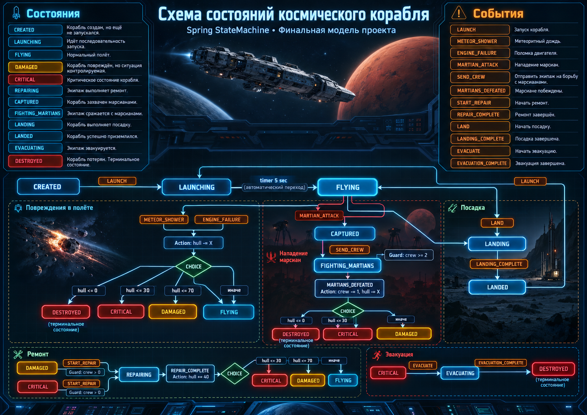

# StarMachine

Учебный проект для изучения **Spring StateMachine** на примере управления космическим кораблём.

Проект показывает, как строить конечный автомат с состояниями, событиями, действиями, условиями переходов и сохранением состояния в базе данных.

## Что есть в проекте

- Spring Boot
- Spring StateMachine
- PostgreSQL
- Spring Data JPA
- Thymeleaf + JavaScript
- сохранение состояния StateMachine
- `Action`
- `Guard`
- `Choice`
- `ExtendedState`
- автоматические переходы по таймеру

## Схема состояний



Корабль может:

- запускаться;
- получать повреждения;
- попадать под метеоритный дождь;
- переживать отказ двигателя;
- сражаться с марсианами;
- ремонтироваться;
- садиться;
- эвакуировать экипаж;
- быть уничтоженным.

## Основная идея

Для каждого корабля создаётся отдельный экземпляр `StateMachine`.

Связь между кораблём и автоматом хранится отдельно:

```text
Spaceship
    ↕
SpaceshipStateMachine
    ↕
StateMachine
```

Бизнес-данные корабля, например:

```text
hull
crew
```

влияют на переходы между состояниями через `Guard` и `Choice`.

Дополнительные данные событий передаются через `ExtendedState`.

## Запуск

Необходимы:

```text
Java 17+
PostgreSQL
Maven
```

Запуск:

```bash
mvn spring-boot:run
```

После запуска открыть:

```text
http://localhost:8080
```

## Цель проекта

Проект предназначен для практического изучения Spring StateMachine — от простых переходов между состояниями до более сложной логики с `Action`, `Guard`, `Choice`, таймерами и persistence.